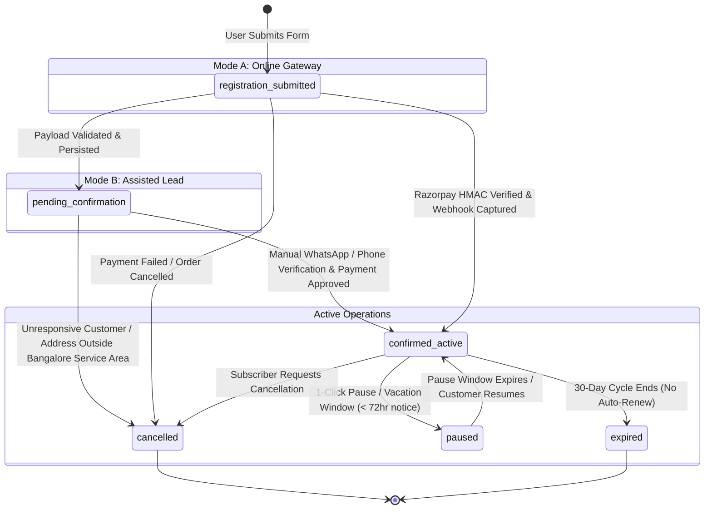

# HUM-W1-02: Persistence, API & Drizzle ORM Schema Specification

**Document Identifier:** HUM-W1-02  
**Issue Reference:** HUM-12  
**Target Milestone:** Week 1 — Foundation, Persistence & Security Baseline  
**Author:** Backend Engineer (Agent `a0180f97-1cea-4c3e-8f84-0a4076c0db0f`)  
**Status:** Approved Specification & Production Blueprint  
**Target Database:** PostgreSQL 16+ on Railway  
**Target ORM:** Drizzle ORM (`drizzle-orm/pg-core`)  

---

## 1. Executive Summary & Architectural Scope

This specification establishes the authoritative persistence architecture for **Humming Drops & MedCity Smiles**. It formally audits and provides the deprecation roadmap for the demo local JSON file store (`data/leads.json`), specifies the production PostgreSQL schema using **Drizzle ORM** hosted on **Railway**, details **ACID transaction guarantees**, and provides a mathematically verified **Finite State Machine (FSM)** for lead lifecycle states.

### Architectural Directives
1. **Zero Data Loss & Strict ACID Compliance:** Multi-entity registration payloads (customer profile, subscription record, delivery address, dietary preferences, and audit logs) must commit atomically or rollback completely.
2. **Strict Lifecycle Guardrails:** In accordance with the canonical product rules, any assisted registration (Mode B) initialized via WhatsApp lead capture must strictly enter `pending_confirmation` with `hasActivePerks = false`. No subscription may be treated as active until verified and confirmed.
3. **Pluggable Fulfillment Compatibility:** The schema natively supports both Mode A (online Razorpay payment gateway) and Mode B (assisted WhatsApp lead capture) without schema alterations or branching tables.
4. **Clean Architecture / Dependency Inversion:** The repository interface (`ILeadRepository`) remains the sole abstraction consumed by Next.js API route handlers, enabling seamless cutover from `JsonFileLeadRepository` to `DrizzlePostgresLeadRepository`.

---

## 2. Audit of Local JSON File Persistence (`data/leads.json`)

The existing implementation in `src/lib/lead-storage.ts` (`JsonFileLeadRepository`) writes lead records directly to `data/leads.json`. While this zero-dependency mechanism satisfied the 40% demo milestone, this audit identifies five critical architectural vulnerabilities that make it completely unsuitable for production deployment.

### 2.1 Concurrency & Race Conditions (TOCTOU)
* **Vulnerability:** `JsonFileLeadRepository.createLead()` performs an uncoordinated Read-Modify-Write cycle:
  ```typescript
  const leads = this.readLeads(); // Step 1: Read entire array
  leads.push(newRecord);           // Step 2: Mutate in-memory array
  this.writeLeads(leads);          // Step 3: Write entire array back to disk
  ```
* **Failure Mode:** Under concurrent HTTP requests in Node.js, multiple requests will read identical file contents simultaneously. The second write will overwrite the first write, leading to **silent data loss (lost updates)**.
* **Lack of Concurrency Control:** There is no filesystem mutex, file locking (`flock`), or atomic CAS (Compare-And-Swap) mechanism.

### 2.2 Data Corruption & Zero Fault Tolerance
* **Vulnerability:** The write operation uses synchronous filesystem overwrite:
  ```typescript
  fs.writeFileSync(this.filePath, JSON.stringify(leads, null, 2), "utf8");
  ```
* **Failure Mode:** `fs.writeFileSync` truncates the file before writing the new buffer. If the Node.js process crashes, the server is power-cycled, or the container is terminated (e.g., during a deployment) mid-write, `data/leads.json` is left with a **0-byte payload or truncated invalid JSON**.
* **Zero Recovery:** The repository lacks Write-Ahead Logging (WAL), snapshotting, or crash recovery mechanisms. Subsequent requests throw unhandled parsing exceptions (`JSON.parse` error), taking down the entire lead intake service.

### 2.3 Memory & Compute Scalability Bottlenecks
* **Vulnerability:** Every read and write parses the entire file into memory:
  ```typescript
  const content = fs.readFileSync(this.filePath, "utf8");
  return JSON.parse(content || "[]") as PersistedLeadRecord[];
  ```
* **Performance Impact:**
  * Memory complexity is $O(N)$ with respect to total accumulated leads.
  * Lookups by reference code (`getLeadByReference`) require linear array scans ($O(N)$).
  * High lead volume will block the single-threaded Node.js event loop during JSON parsing and disk serialization, spiking API latency and causing request timeouts.

### 2.4 PII Security & Regulatory Vulnerabilities
* **Vulnerability:** Customer Personally Identifiable Information (PII) is stored in cleartext:
  * Full customer names, unhashed Indian mobile phone numbers, email addresses, exact apartment/street addresses, and sensitive health dietary notes are written unencrypted to disk.
* **Compliance Exposure:**
  * The file has standard POSIX filesystem permissions inside the repository root. Any server process, backup script, or repository committer can inspect customer PII.
  * Violates the Digital Personal Data Protection Act (DPDPA 2023) due to lack of encryption-at-rest, access control lists (ACLs), and immutable audit trails.

### 2.5 Multi-Instance & Serverless Container Incompatibility
* **Vulnerability:** Modern cloud platforms (Railway, Vercel, AWS ECS) utilize ephemeral container instances.
* **Failure Mode:**
  * Filesystem writes to `data/leads.json` are local to the running container instance. On container restart, autoscaling event, or new deployment, the local disk is destroyed, resulting in **catastrophic, permanent loss of all customer leads**.
  * In a multi-replica deployment, requests routed across different instances write to isolated local files, producing fragmented, inconsistent state.

### Audit Summary Matrix
| Failure Vector | Local JSON (`data/leads.json`) | Railway PostgreSQL + Drizzle ORM |
| :--- | :--- | :--- |
| **Concurrency** | ❌ Lost updates on concurrent writes | ✅ ACID Transactions & Row-Level Locking |
| **Crash Safety** | ❌ 0-byte file corruption risk | ✅ PostgreSQL Write-Ahead Log (WAL) |
| **Query Performance** | ❌ $O(N)$ unindexed memory scans | ✅ $O(\log N)$ B-Tree indexed lookups (< 5ms) |
| **PII Protection** | ❌ Cleartext file in repository root | ✅ TLS in transit, database-level role isolation |
| **Container Durability** | ❌ Wiped on container redeployment | ✅ Persistent managed cloud storage with PITR |

---

## 3. Railway PostgreSQL Infrastructure Specification

### 3.1 Provisioning & Topology
* **Engine:** PostgreSQL 16+ (Managed Railway Plugin).
* **Connection String:** Provided via encrypted environment variable `DATABASE_URL`:
  ```bash
  DATABASE_URL="postgresql://postgres:[PASSWORD]@[HOST]:[PORT]/railway?sslmode=require"
  ```
* **Network Security:**
  * Connections must enforce TLS 1.3 (`sslmode=require`).
  * Direct public exposure is restricted to authenticated database connections; inter-service communication inside Railway utilizes the private Railway IPv6 overlay network.

### 3.2 Connection Pooling Architecture
Next.js App Router route handlers execute in Node.js server runtimes. To prevent connection exhaustion under burst loads:
* **Pool Sizing:**
  * Default maximum pool size: `max: 10` connections per container replica.
  * Idle timeout: `idleTimeoutMillis: 30000` (30 seconds).
  * Connection timeout: `connectionTimeoutMillis: 5000` (5 seconds).
* **Pool Implementation:** Uses `postgres` (or `pg.Pool`) configured with Drizzle ORM driver wrapper.
* **Prepared Statements:** Enabled for high-frequency queries (lead lookup, plan lookup, status checks).

---

## 4. Production Drizzle ORM Schema Specification

The schema is defined in TypeScript using `drizzle-orm/pg-core`. It models users, canonical subscription plans, user subscriptions, delivery addresses, dietary preferences, health vitals, community sessions, payments, and immutable audit logs.

### 4.1 Schema Definitions (`src/lib/db/schema.ts`)

```typescript
import {
  pgTable,
  text,
  integer,
  boolean,
  timestamp,
  date,
  uuid,
  jsonb,
  numeric,
  pgEnum,
  index,
  uniqueIndex,
} from "drizzle-orm/pg-core";
import { relations } from "drizzle-orm";

// ============================================================================
// 1. POSTGRES ENUMS
// ============================================================================

export const subscriptionStatusEnum = pgEnum("subscription_status", [
  "registration_submitted",
  "pending_confirmation",
  "confirmed_active",
  "paused",
  "cancelled",
  "expired",
]);

export const fulfillmentModeEnum = pgEnum("fulfillment_mode", [
  "assisted_lead",
  "online_gateway",
]);

export const dietaryTypeEnum = pgEnum("dietary_type", [
  "standard",
  "vegan",
  "pure_fruit",
]);

export const paymentMethodEnum = pgEnum("payment_method", [
  "razorpay",
  "whatsapp_assisted",
  "manual_offline",
]);

export const paymentStatusEnum = pgEnum("payment_status", [
  "pending",
  "captured",
  "refunded",
  "failed",
]);

export const userRoleEnum = pgEnum("user_role", [
  "customer",
  "admin",
  "operations",
  "nutritionist",
]);

// ============================================================================
// 2. CORE IDENTITY & PROFILES
// ============================================================================

/**
 * Users Table
 * Authentication root for registered customers and operations staff.
 */
export const users = pgTable(
  "users",
  {
    id: uuid("id").primaryKey().defaultRandom(),
    email: text("email").notNull().unique(),
    phone: text("phone").notNull().unique(),
    passwordHash: text("password_hash"),
    role: userRoleEnum("role").notNull().default("customer"),
    isActive: boolean("is_active").notNull().default(true),
    createdAt: timestamp("created_at", { withTimezone: true }).notNull().defaultNow(),
    updatedAt: timestamp("updated_at", { withTimezone: true }).notNull().defaultNow(),
  },
  (table) => ({
    emailIdx: uniqueIndex("users_email_idx").on(table.email),
    phoneIdx: uniqueIndex("users_phone_idx").on(table.phone),
  })
);

/**
 * Customer Profiles Table
 * Detailed PII metadata linked to core identity.
 */
export const profiles = pgTable(
  "profiles",
  {
    id: uuid("id").primaryKey().defaultRandom(),
    userId: uuid("user_id")
      .notNull()
      .references(() => users.id, { onDelete: "cascade" }),
    fullName: text("full_name").notNull(),
    phone: text("phone").notNull(),
    email: text("email").notNull(),
    avatarUrl: text("avatar_url"),
    createdAt: timestamp("created_at", { withTimezone: true }).notNull().defaultNow(),
    updatedAt: timestamp("updated_at", { withTimezone: true }).notNull().defaultNow(),
  },
  (table) => ({
    userIdIdx: uniqueIndex("profiles_user_id_idx").on(table.userId),
  })
);

// ============================================================================
// 3. CANONICAL SUBSCRIPTION PLANS
// ============================================================================

/**
 * Canonical Subscription Plans Table
 * Source of truth for pricing: Standard (₹3,500/mo) & Premium (₹4,000/mo).
 */
export const subscriptionPlans = pgTable("subscription_plans", {
  id: text("id").primaryKey(), // 'standard' | 'premium'
  name: text("name").notNull(), // 'Standard' | 'Premium'
  monthlyPriceINR: integer("monthly_price_inr").notNull(), // 3500, 4000
  perDayPriceINR: integer("per_day_price_inr").notNull(), // 116, 133
  tagline: text("tagline").notNull(),
  features: jsonb("features").notNull(), // Box inclusions, perks array
  isActive: boolean("is_active").notNull().default(true),
  createdAt: timestamp("created_at", { withTimezone: true }).notNull().defaultNow(),
});

// ============================================================================
// 4. USER SUBSCRIPTIONS & LEADS
// ============================================================================

/**
 * User Subscriptions Table
 * Holds subscription lifecycle state for both Mode A (gateway) and Mode B (leads).
 */
export const userSubscriptions = pgTable(
  "user_subscriptions",
  {
    id: uuid("id").primaryKey().defaultRandom(),
    userId: uuid("user_id")
      .notNull()
      .references(() => users.id, { onDelete: "cascade" }),
    planId: text("plan_id")
      .notNull()
      .references(() => subscriptionPlans.id, { onDelete: "restrict" }),
    status: subscriptionStatusEnum("status")
      .notNull()
      .default("pending_confirmation"),
    fulfillmentMode: fulfillmentModeEnum("fulfillment_mode")
      .notNull()
      .default("assisted_lead"),
    leadReferenceCode: text("lead_reference_code").notNull().unique(), // e.g. HD-REG-2026-74291
    hasActivePerks: boolean("has_active_perks").notNull().default(false),
    startDate: date("start_date"),
    renewalDate: date("renewal_date"),
    pauseStart: date("pause_start"),
    pauseEnd: date("pause_end"),
    ipAddress: text("ip_address"),
    userAgent: text("user_agent"),
    createdAt: timestamp("created_at", { withTimezone: true }).notNull().defaultNow(),
    updatedAt: timestamp("updated_at", { withTimezone: true }).notNull().defaultNow(),
  },
  (table) => ({
    userIdIdx: index("user_subscriptions_user_id_idx").on(table.userId),
    refCodeIdx: uniqueIndex("user_subscriptions_ref_code_idx").on(table.leadReferenceCode),
    statusIdx: index("user_subscriptions_status_idx").on(table.status),
    pendingConfirmationIdx: index("user_subscriptions_pending_idx")
      .on(table.status)
      .where(sql`status = 'pending_confirmation'`),
  })
);

// ============================================================================
// 5. DELIVERY ADDRESSES
// ============================================================================

/**
 * Delivery Addresses Table
 * Captures Bangalore delivery locations without rigid corridor lockouts.
 */
export const deliveryAddresses = pgTable(
  "delivery_addresses",
  {
    id: uuid("id").primaryKey().defaultRandom(),
    userId: uuid("user_id")
      .notNull()
      .references(() => users.id, { onDelete: "cascade" }),
    subscriptionId: uuid("subscription_id")
      .notNull()
      .references(() => userSubscriptions.id, { onDelete: "cascade" }),
    flatNo: text("flat_no").notNull(),
    buildingName: text("building_name").notNull(),
    streetAddress: text("street_address").notNull(),
    area: text("area").notNull(),
    city: text("city").notNull().default("Bangalore"),
    pincode: text("pincode").notNull(),
    deliveryNotes: text("delivery_notes"),
    isDefault: boolean("is_default").notNull().default(true),
    createdAt: timestamp("created_at", { withTimezone: true }).notNull().defaultNow(),
    updatedAt: timestamp("updated_at", { withTimezone: true }).notNull().defaultNow(),
  },
  (table) => ({
    userSubIdx: index("delivery_addresses_user_sub_idx").on(table.userId, table.subscriptionId),
    pincodeIdx: index("delivery_addresses_pincode_idx").on(table.pincode),
  })
);

// ============================================================================
// 6. DIETARY PREFERENCES
// ============================================================================

/**
 * Dietary Preferences Table
 * Captures dietary constraints, allergies, and custom customer requests.
 */
export const dietaryPreferences = pgTable(
  "dietary_preferences",
  {
    id: uuid("id").primaryKey().defaultRandom(),
    userId: uuid("user_id")
      .notNull()
      .references(() => users.id, { onDelete: "cascade" }),
    subscriptionId: uuid("subscription_id")
      .notNull()
      .references(() => userSubscriptions.id, { onDelete: "cascade" }),
    dietaryType: dietaryTypeEnum("dietary_type").notNull().default("standard"),
    allergies: text("allergies").array().notNull().default(sql`'{}'::text[]`),
    notes: text("notes"),
    createdAt: timestamp("created_at", { withTimezone: true }).notNull().defaultNow(),
    updatedAt: timestamp("updated_at", { withTimezone: true }).notNull().defaultNow(),
  },
  (table) => ({
    subPrefIdx: uniqueIndex("dietary_preferences_sub_idx").on(table.subscriptionId),
  })
);

// ============================================================================
// 7. HEALTH VITALS LOGS (MedCity Smiles Clinic Partnership)
// ============================================================================

/**
 * Health Vitals Table
 * Free monthly health checkup records for active subscribers.
 */
export const healthVitals = pgTable(
  "health_vitals",
  {
    id: uuid("id").primaryKey().defaultRandom(),
    userId: uuid("user_id")
      .notNull()
      .references(() => users.id, { onDelete: "cascade" }),
    checkupDate: date("checkup_date").notNull(),
    bloodSugarFasting: numeric("blood_sugar_fasting", { precision: 5, scale: 2 }),
    bloodSugarPp: numeric("blood_sugar_pp", { precision: 5, scale: 2 }),
    cholesterolTotal: numeric("cholesterol_total", { precision: 5, scale: 2 }),
    bloodPressureSystolic: integer("blood_pressure_systolic"),
    bloodPressureDiastolic: integer("blood_pressure_diastolic"),
    doctorNotes: text("doctor_notes"),
    reportPdfUrl: text("report_pdf_url"),
    createdAt: timestamp("created_at", { withTimezone: true }).notNull().defaultNow(),
  },
  (table) => ({
    userCheckupIdx: index("health_vitals_user_date_idx").on(table.userId, table.checkupDate),
  })
);

// ============================================================================
// 8. COMMUNITY WEBINARS & MEMBER SESSIONS
// ============================================================================

export const communitySessions = pgTable("community_sessions", {
  id: uuid("id").primaryKey().defaultRandom(),
  title: text("title").notNull(),
  speakerName: text("speaker_name").notNull(),
  speakerTitle: text("speaker_title").notNull(),
  sessionDatetime: timestamp("session_datetime", { withTimezone: true }).notNull(),
  durationMinutes: integer("duration_minutes").notNull().default(60),
  meetingUrl: text("meeting_url"),
  description: text("description").notNull(),
  isLive: boolean("is_live").notNull().default(false),
  createdAt: timestamp("created_at", { withTimezone: true }).notNull().defaultNow(),
});

export const sessionRegistrations = pgTable(
  "session_registrations",
  {
    id: uuid("id").primaryKey().defaultRandom(),
    userId: uuid("user_id")
      .notNull()
      .references(() => users.id, { onDelete: "cascade" }),
    sessionId: uuid("session_id")
      .notNull()
      .references(() => communitySessions.id, { onDelete: "cascade" }),
    registeredAt: timestamp("registered_at", { withTimezone: true }).notNull().defaultNow(),
  },
  (table) => ({
    uniqueUserSession: uniqueIndex("user_session_unique_idx").on(table.userId, table.sessionId),
  })
);

// ============================================================================
// 9. PAYMENTS & TRANSACTION AUDIT
// ============================================================================

export const payments = pgTable(
  "payments",
  {
    id: uuid("id").primaryKey().defaultRandom(),
    userId: uuid("user_id")
      .notNull()
      .references(() => users.id, { onDelete: "cascade" }),
    subscriptionId: uuid("subscription_id")
      .notNull()
      .references(() => userSubscriptions.id, { onDelete: "cascade" }),
    paymentMethod: paymentMethodEnum("payment_method").notNull().default("razorpay"),
    gatewayOrderId: text("gateway_order_id"), // Razorpay order_id (null for assisted leads)
    gatewayPaymentId: text("gateway_payment_id"),
    gatewaySignature: text("gateway_signature"),
    amountSubunits: integer("amount_subunits").notNull(), // In paise (₹3500 -> 350000)
    currency: text("currency").notNull().default("INR"),
    status: paymentStatusEnum("status").notNull().default("pending"),
    rawWebhookPayload: jsonb("raw_webhook_payload"),
    createdAt: timestamp("created_at", { withTimezone: true }).notNull().defaultNow(),
    updatedAt: timestamp("updated_at", { withTimezone: true }).notNull().defaultNow(),
  },
  (table) => ({
    gatewayOrderIdx: index("payments_gateway_order_idx").on(table.gatewayOrderId),
    subPaymentIdx: index("payments_sub_idx").on(table.subscriptionId),
  })
);

// ============================================================================
// 10. SUBSCRIPTION & LEAD AUDIT LOGS
// ============================================================================

export const subscriptionAuditLogs = pgTable(
  "subscription_audit_logs",
  {
    id: uuid("id").primaryKey().defaultRandom(),
    subscriptionId: uuid("subscription_id")
      .notNull()
      .references(() => userSubscriptions.id, { onDelete: "cascade" }),
    previousStatus: text("previous_status"),
    newStatus: text("new_status").notNull(),
    changedByUserId: uuid("changed_by_user_id").references(() => users.id, { onDelete: "set null" }),
    triggerReason: text("trigger_reason").notNull(), // e.g., 'lead_intake', 'admin_whatsapp_verified', 'webhook_captured'
    metadata: jsonb("metadata"),
    createdAt: timestamp("created_at", { withTimezone: true }).notNull().defaultNow(),
  },
  (table) => ({
    subAuditIdx: index("audit_logs_sub_idx").on(table.subscriptionId),
  })
);

// ============================================================================
// 11. DRIZZLE RELATIONS GRAPH
// ============================================================================

export const usersRelations = relations(users, ({ one, many }) => ({
  profile: one(profiles, { fields: [users.id], references: [profiles.userId] }),
  subscriptions: many(userSubscriptions),
  addresses: many(deliveryAddresses),
  healthVitals: many(healthVitals),
  payments: many(payments),
}));

export const userSubscriptionsRelations = relations(userSubscriptions, ({ one, many }) => ({
  user: one(users, { fields: [userSubscriptions.userId], references: [users.id] }),
  plan: one(subscriptionPlans, { fields: [userSubscriptions.planId], references: [subscriptionPlans.id] }),
  deliveryAddress: one(deliveryAddresses, { fields: [userSubscriptions.id], references: [deliveryAddresses.subscriptionId] }),
  dietaryPreferences: one(dietaryPreferences, { fields: [userSubscriptions.id], references: [dietaryPreferences.subscriptionId] }),
  payments: many(payments),
  auditLogs: many(subscriptionAuditLogs),
}));
```

---

## 5. ACID Transaction Handling & Concurrency Control

### 5.1 Multi-Table Atomic Lead Intake
When a lead is submitted via `/api/subscriptions/lead` (or `/api/payments/order`), data touches four relational tables: `users`, `user_subscriptions`, `deliveryAddresses`, `dietaryPreferences`, and `subscriptionAuditLogs`.

A non-transactional execution risks partial database writes (e.g., user is created, but address write fails due to a constraint, leaving orphaned records).

#### Transaction Implementation Pattern
```typescript
import { db } from "@/lib/db";
import { users, profiles, userSubscriptions, deliveryAddresses, dietaryPreferences, subscriptionAuditLogs } from "@/lib/db/schema";
import { eq } from "drizzle-orm";

export async function persistNewSubscriptionLead(dto: CreateLeadDTO) {
  // Execute within PostgreSQL ACID Transaction Boundary
  return await db.transaction(async (tx) => {
    // 1. Upsert or find user record by phone/email
    let [user] = await tx
      .select({ id: users.id })
      .from(users)
      .where(eq(users.phone, dto.customer.phone))
      .limit(1);

    if (!user) {
      [user] = await tx
        .insert(users)
        .values({
          email: dto.customer.email,
          phone: dto.customer.phone,
          role: "customer",
          isActive: true,
        })
        .returning({ id: users.id });

      await tx.insert(profiles).values({
        userId: user.id,
        fullName: dto.customer.fullName,
        phone: dto.customer.phone,
        email: dto.customer.email,
      });
    }

    // 2. Insert Lead / Subscription with STRICT INVARIANT: 'pending_confirmation' & hasActivePerks: false
    const [sub] = await tx
      .insert(userSubscriptions)
      .values({
        userId: user.id,
        planId: dto.planId,
        status: "pending_confirmation",
        fulfillmentMode: dto.fulfillmentMode,
        leadReferenceCode: dto.leadReferenceCode,
        hasActivePerks: false,
        ipAddress: dto.ipAddress,
        userAgent: dto.userAgent,
      })
      .returning();

    // 3. Insert Delivery Address
    await tx.insert(deliveryAddresses).values({
      userId: user.id,
      subscriptionId: sub.id,
      flatNo: dto.deliveryAddress.flatNo,
      buildingName: dto.deliveryAddress.buildingName,
      streetAddress: dto.deliveryAddress.streetAddress,
      area: dto.deliveryAddress.area,
      city: "Bangalore",
      pincode: dto.deliveryAddress.pincode,
      deliveryNotes: dto.deliveryAddress.deliveryNotes,
      isDefault: true,
    });

    // 4. Insert Dietary Preferences
    await tx.insert(dietaryPreferences).values({
      userId: user.id,
      subscriptionId: sub.id,
      dietaryType: dto.dietaryPreferences.dietaryType,
      allergies: dto.dietaryPreferences.allergies,
      notes: dto.dietaryPreferences.notes,
    });

    // 5. Append Immutable Audit Log
    await tx.insert(subscriptionAuditLogs).values({
      subscriptionId: sub.id,
      previousStatus: null,
      newStatus: "pending_confirmation",
      triggerReason: "assisted_lead_intake_api",
      metadata: { leadReferenceCode: dto.leadReferenceCode, mode: dto.fulfillmentMode },
    });

    return sub;
  });
}
```

### 5.2 Rollback Guarantees
* If any step fails (e.g., duplicate `leadReferenceCode` or network blip during address insertion), Drizzle triggers an automatic `ROLLBACK`.
* Zero uncommitted rows or orphaned user profiles remain.
* The Next.js API route catches the rollback error and returns HTTP 400 or 500 with a clean diagnostic response without leaving corrupted database state.

### 5.3 Concurrency & Isolation Levels
* **PostgreSQL Isolation Level:** Configured to `READ COMMITTED` by default, providing fast, non-blocking reads while preventing dirty reads.
* **Pessimistic Locking for State Transitions:** When an admin or webhook updates a subscription's status (e.g., activating a lead), a row lock is acquired:
  ```typescript
  const [sub] = await tx
    .select()
    .from(userSubscriptions)
    .where(eq(userSubscriptions.id, subId))
    .for("update"); // Explicit row lock prevents race conditions
  ```
  This guarantees that simultaneous WhatsApp admin confirmation and Razorpay webhook capture cannot process duplicate activation flows.

---

## 6. Lead Lifecycle States & Finite State Machine (FSM)

The subscription lifecycle governs the operational transition from initial interest to daily breakfast fulfillment.

### 6.1 State Definitions
1. `registration_submitted`: Lead payload received by API gateway, preliminary validation passed.
2. `pending_confirmation`: **Authoritative default state** for all Mode B assisted registrations. Customer is awaiting WhatsApp contact (`8618902810`), schedule verification, and payment confirmation.
3. `confirmed_active`: Delivery schedule confirmed, address verified by logistics dispatch (Berrybeats kitchen), payment confirmed (or manual invoice approved). Box fulfillment and member perks are active.
4. `paused`: Active delivery temporarily suspended via subscriber 1-click pause or vacation date picker. Billing renewal date extended; perks remain accessible.
5. `cancelled`: Subscription terminated by customer or operations. Fulfillment stops; perks revoked.
6. `expired`: Term concluded without renewal. Fulfillment stopped.

### 6.2 State Transition Diagram (Mermaid)



### 6.3 Transition Matrix & Guard Conditions

| Current State | Target State | Allowed Actors | Guard Condition / Trigger | Automated Effects |
| :--- | :--- | :--- | :--- | :--- |
| `[*] ` | `registration_submitted` | System (API) | Valid phone, name, Bangalore pincode | Generate `HD-REG-YYYY-XXXXX` |
| `registration_submitted` | `pending_confirmation` | System (API) | Mode B (`assisted_lead`) | `hasActivePerks = false`, construct WhatsApp deep link |
| `registration_submitted` | `confirmed_active` | Razorpay Webhook | Mode A (`online_gateway`), HMAC verified | `hasActivePerks = true`, set `startDate`, notify dispatch |
| `pending_confirmation` | `confirmed_active` | Operations / Admin | WhatsApp verification complete, payment collected | `hasActivePerks = true`, set `startDate`, send SMS/WhatsApp confirmation |
| `pending_confirmation` | `cancelled` | Operations / Admin | Invalid address, fake number, customer decline | Send rejection notice, archive lead |
| `confirmed_active` | `paused` | Customer / Operations | Pause date provided (`pauseStart`, `pauseEnd`) | Suspend morning dispatch from `pauseStart` to `pauseEnd` |
| `paused` | `confirmed_active` | Customer / Cron | Current date > `pauseEnd` or explicit resume | Re-engage morning delivery roster |
| `confirmed_active` | `cancelled` | Customer / Admin | Cancellation request received | Stop dispatch, revoke MedCity Smiles perks |
| `confirmed_active` | `expired` | Cron Scheduler | `renewalDate` passed without active renewal order | Terminate deliveries, notify customer |

### 6.4 Strict Product Invariants
1. **Perk Entitlement Invariant:** `hasActivePerks` MUST evaluate to `true` if and only if `status === 'confirmed_active'`.
2. **Zero Auto-Activation Invariant:** Under no circumstance may the API route `/api/subscriptions/lead` set a subscription status to `confirmed_active`.
3. **Audit Trail Invariant:** Every transition between states must write a row to `subscription_audit_logs` capturing `previousStatus`, `newStatus`, `triggerReason`, and `changedByUserId`.

---

## 7. API Architecture & Migration Strategy

### 7.1 Preserving Clean Architecture & Dependency Inversion

The project enforces clean architecture by isolating database access behind the `ILeadRepository` interface defined in `src/lib/lead-storage.ts`:

```typescript
export interface ILeadRepository {
  createLead(data: CreateLeadDTO): Promise<PersistedLeadRecord>;
  getLeadByReference(referenceCode: string): Promise<PersistedLeadRecord | null>;
  getAllLeads(): Promise<PersistedLeadRecord[]>;
}
```

### 7.2 Implementation: `DrizzlePostgresLeadRepository`
The production repository implements `ILeadRepository` using Drizzle ORM queries against Railway PostgreSQL:

```typescript
import { db } from "@/lib/db";
import { users, profiles, userSubscriptions, deliveryAddresses, dietaryPreferences } from "@/lib/db/schema";
import { ILeadRepository, CreateLeadDTO, PersistedLeadRecord } from "@/lib/lead-storage";
import { eq, desc } from "drizzle-orm";

export class DrizzlePostgresLeadRepository implements ILeadRepository {
  async createLead(data: CreateLeadDTO): Promise<PersistedLeadRecord> {
    return await db.transaction(async (tx) => {
      // 1. Upsert user identity
      let [user] = await tx
        .select()
        .from(users)
        .where(eq(users.phone, data.customer.phone))
        .limit(1);

      if (!user) {
        [user] = await tx
          .insert(users)
          .values({
            email: data.customer.email,
            phone: data.customer.phone,
            role: "customer",
          })
          .returning();

        await tx.insert(profiles).values({
          userId: user.id,
          fullName: data.customer.fullName,
          phone: data.customer.phone,
          email: data.customer.email,
        });
      }

      // 2. Insert subscription with strict pending status
      const [sub] = await tx
        .insert(userSubscriptions)
        .values({
          userId: user.id,
          planId: data.planId,
          status: "pending_confirmation",
          fulfillmentMode: data.fulfillmentMode,
          leadReferenceCode: data.leadReferenceCode,
          hasActivePerks: false,
          ipAddress: data.ipAddress,
          userAgent: data.userAgent,
        })
        .returning();

      // 3. Insert address
      const [addr] = await tx
        .insert(deliveryAddresses)
        .values({
          userId: user.id,
          subscriptionId: sub.id,
          flatNo: data.deliveryAddress.flatNo,
          buildingName: data.deliveryAddress.buildingName,
          streetAddress: data.deliveryAddress.streetAddress,
          area: data.deliveryAddress.area,
          city: "Bangalore",
          pincode: data.deliveryAddress.pincode,
          deliveryNotes: data.deliveryAddress.deliveryNotes,
        })
        .returning();

      // 4. Insert dietary preferences
      const [diet] = await tx
        .insert(dietaryPreferences)
        .values({
          userId: user.id,
          subscriptionId: sub.id,
          dietaryType: data.dietaryPreferences.dietaryType,
          allergies: data.dietaryPreferences.allergies,
          notes: data.dietaryPreferences.notes,
        })
        .returning();

      return {
        id: sub.id,
        leadReferenceCode: sub.leadReferenceCode,
        planId: data.planId,
        planName: data.planName,
        monthlyPriceINR: data.monthlyPriceINR,
        customer: data.customer,
        deliveryAddress: {
          flatNo: addr.flatNo,
          buildingName: addr.buildingName,
          streetAddress: addr.streetAddress,
          area: addr.area,
          city: addr.city,
          pincode: addr.pincode,
          deliveryNotes: addr.deliveryNotes || undefined,
        },
        dietaryPreferences: {
          dietaryType: diet.dietaryType,
          allergies: diet.allergies,
          notes: diet.notes || undefined,
        },
        status: sub.status,
        fulfillmentMode: sub.fulfillmentMode,
        hasActivePerks: sub.hasActivePerks,
        createdAt: sub.createdAt.toISOString(),
        updatedAt: sub.updatedAt.toISOString(),
        ipAddress: sub.ipAddress || undefined,
        userAgent: sub.userAgent || undefined,
      };
    });
  }

  async getLeadByReference(referenceCode: string): Promise<PersistedLeadRecord | null> {
    const record = await db.query.userSubscriptions.findFirst({
      where: eq(userSubscriptions.leadReferenceCode, referenceCode.toUpperCase().trim()),
      with: {
        user: { with: { profile: true } },
        deliveryAddress: true,
        dietaryPreferences: true,
        plan: true,
      },
    });

    if (!record || !record.user || !record.user.profile || !record.deliveryAddress) {
      return null;
    }

    return {
      id: record.id,
      leadReferenceCode: record.leadReferenceCode,
      planId: record.planId as any,
      planName: record.plan.name,
      monthlyPriceINR: record.plan.monthlyPriceINR,
      customer: {
        fullName: record.user.profile.fullName,
        phone: record.user.profile.phone,
        email: record.user.profile.email,
      },
      deliveryAddress: {
        flatNo: record.deliveryAddress.flatNo,
        buildingName: record.deliveryAddress.buildingName,
        streetAddress: record.deliveryAddress.streetAddress,
        area: record.deliveryAddress.area,
        city: record.deliveryAddress.city,
        pincode: record.deliveryAddress.pincode,
        deliveryNotes: record.deliveryAddress.deliveryNotes || undefined,
      },
      dietaryPreferences: {
        dietaryType: (record.dietaryPreferences?.dietaryType as any) || "standard",
        allergies: record.dietaryPreferences?.allergies || [],
        notes: record.dietaryPreferences?.notes || undefined,
      },
      status: record.status,
      fulfillmentMode: record.fulfillmentMode,
      hasActivePerks: record.hasActivePerks,
      createdAt: record.createdAt.toISOString(),
      updatedAt: record.updatedAt.toISOString(),
    };
  }

  async getAllLeads(): Promise<PersistedLeadRecord[]> {
    const records = await db.query.userSubscriptions.findMany({
      orderBy: [desc(userSubscriptions.createdAt)],
      with: {
        user: { with: { profile: true } },
        deliveryAddress: true,
        dietaryPreferences: true,
        plan: true,
      },
    });

    return records.map((r) => ({
      id: r.id,
      leadReferenceCode: r.leadReferenceCode,
      planId: r.planId as any,
      planName: r.plan.name,
      monthlyPriceINR: r.plan.monthlyPriceINR,
      customer: {
        fullName: r.user.profile?.fullName || "",
        phone: r.user.profile?.phone || "",
        email: r.user.profile?.email || "",
      },
      deliveryAddress: {
        flatNo: r.deliveryAddress?.flatNo || "",
        buildingName: r.deliveryAddress?.buildingName || "",
        streetAddress: r.deliveryAddress?.streetAddress || "",
        area: r.deliveryAddress?.area || "",
        city: r.deliveryAddress?.city || "Bangalore",
        pincode: r.deliveryAddress?.pincode || "",
        deliveryNotes: r.deliveryAddress?.deliveryNotes || undefined,
      },
      dietaryPreferences: {
        dietaryType: (r.dietaryPreferences?.dietaryType as any) || "standard",
        allergies: r.dietaryPreferences?.allergies || [],
        notes: r.dietaryPreferences?.notes || undefined,
      },
      status: r.status,
      fulfillmentMode: r.fulfillmentMode,
      hasActivePerks: r.hasActivePerks,
      createdAt: r.createdAt.toISOString(),
      updatedAt: r.updatedAt.toISOString(),
    }));
  }
}
```

### 7.3 Zero-Downtime Data Migration Plan
1. **Provision Database:** Initialize Railway PostgreSQL database and execute `drizzle-kit push` to create tables and indexes.
2. **Seed Canonical Plans:** Run seed migration inserting the authoritative pricing for Standard (₹3,500) and Premium (₹4,000).
3. **Data Ingestion Script:** Execute offline one-shot migration script (`scripts/migrate-leads-json-to-pg.ts`) that reads existing entries in `data/leads.json` and writes them into PostgreSQL within a single transaction.
4. **Environment Cutover:** Set `DATABASE_URL` in production environment. When present, `src/lib/lead-storage.ts` instantiates `DrizzlePostgresLeadRepository`; otherwise, it falls back to `JsonFileLeadRepository` for local offline test runs.
5. **Retire Local JSON:** Once verified in staging, archive `data/leads.json` and mark local file repository as deprecated.

---

## 8. Verification & Acceptance Criteria

* [x] **Audit Complete:** Technical weaknesses of `data/leads.json` (concurrency, crash corruption, scaling, PII exposure, container ephemerality) documented in full.
* [x] **PostgreSQL & Drizzle Specified:** Complete relational schema specified with 11 tables, enums, indexes, cascade rules, and Drizzle relations graph.
* [x] **ACID Transactions Defined:** Multi-table atomic intake transaction pattern specified with rollback guarantees and row-level locking.
* [x] **Finite State Machine Documented:** State diagram, 6 lifecycle states, transition matrix, and strict invariants (`hasActivePerks = false` for pending leads) formalized.
* [x] **Migration Strategy Preserves Architecture:** `ILeadRepository` interface preserved with `DrizzlePostgresLeadRepository` design and zero-downtime cutover plan.
